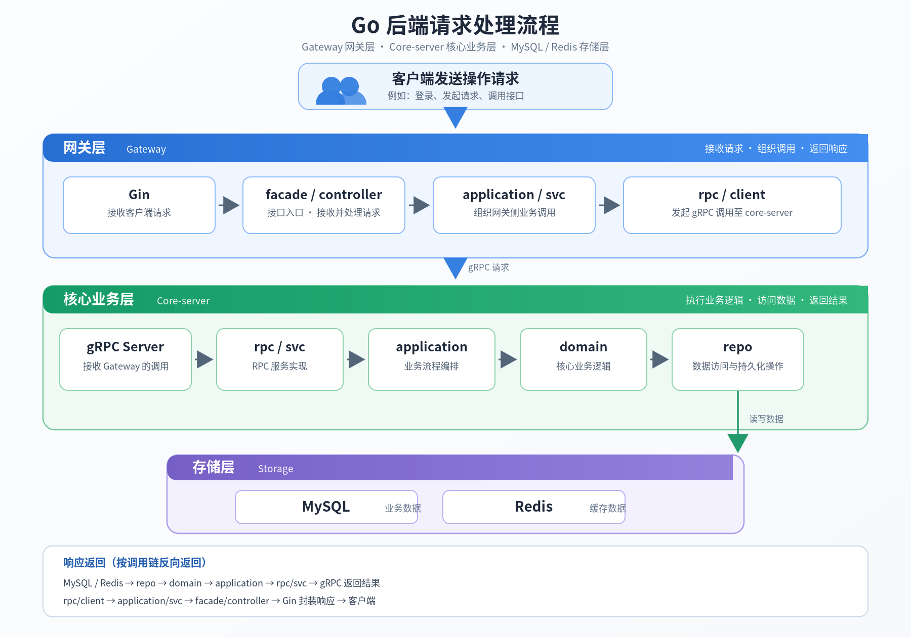

# 分布式博客项目

## 快速开始
### 前端服务
```bash
cd frontend
npm install
npm run dev
```

### 网关服务
```bash
# 首先确保本机mysql和redis均已打开
cd gateway
go mod tidy
make wire  #重新生成依赖注入代码（在修改依赖注入逻辑之后需要执行）
make generate-proto-rpc  #如果需要，在修改 .proto 文件之后执行，更新原有的pb代码
go run ./cmd/server # 推荐这样运行，可以直接编译到生成的wire产物
```


### 内部核心服务
```bash
# 首先确保本机mysql和redis均已打开
cd core-server
go mod tidy
make wire  #同上
make generate-proto-rpc #同上
go run ./cmd/server #同上
```

## 技术选型
| 类别       | 技术             | 说明                                                                                            |
|------------|------------------|-------------------------------------------------------------------------------------------------|
| Go         | 1.27             |                                                                                                 |
| HTTP框架   | Gin              | 路由、中间件、Json响应                                                                          |
| RPC框架    | gRPC             | 服务间通信，监听8081端口                                                                        |
| 持久层     | GORM、Ent、Mysql | 业务服务使用Ent，用代码定义模型，把错误挡在编译期<br/>网关会话AI使用GORM。最终都是存入到sql表。 |
| 缓存       | Redis            | 用于验证码、登陆黑名单以及鉴权黑名单的数据存放                                                  |
| 工程化     | Wire、Zap、Yaml  | Wire依赖注入、Zap结构化日志、yaml配置文件类型                                                   |
| AI博客助手 | Eino             | Go语言的AI开发框架                                                                              |


### 目录结构
```
gateway/
├── cmd/
│   └── server/               
│       ├── main.go          # 网关启动入口 
│       ├── wire.go          # 网关注入生成规则 
│       └── wire_gen.go      # 注入生成文件
├── config/
│   └── config.yaml          # 配置文件 
├── docs/
│   └── proto/               # proto文件存放位置
├── internal/
│   ├── application          # 网关核心处理组块
│   ├── client               # http与grpc客户端定义
│   │   ├── wire.go
│   │   └── rpc/
│   │       ├── rpcclient.go  
│   │       └── core_rpc/
│   │           └── healthpb/ 
│   ├── config/              # 配置结构体定义
│   │   ├── config.go        
│   │   └── conf_rpc.go       
│   ├── facade/              # 前端请求的直接调用组块 
│   │   ├── wire.go
│   │   ├── router/          # 各个模块路由定义
│   │   │   └── router.go     
│   │   └── controller/      # 负责转发请求到网关核心组块
│   │       └── health_ctrl.go
│   ├── infras/              # 网关用到的基础设施的定义，像日志缓存等
│   ├── model/               # 网关内用到的各种数据定义 
│   │   └── reponse/          
│   │       └── health.go
│   └── server/              # Gin监听的启动与关闭        
│       ├── server.go         
│       └── wire.go
├── Makefile
├── go.mod
└── go.sum
```

```
core-server/
├── cmd/
│   ├── server/                 
│   │   ├── main.go          # 核心组件的程序主入口            
│   │   ├── wire.go             
│   │   └── wire_gen.go         
│   └── cli/                    
├── config/                     
│   └── config.yaml          # 配置文件
├── docs/                    
│   └── proto/               # proto文件定义   
│       └── health.proto
├── internal/
│   ├── config/              # 配置文件所用到的结构体定义   
│   │   ├── config.go           
│   │   ├── conf_mysql.go       
│   │   └── conf_redis.go       
│   ├── domain/              # 数据操作层的接口定义       
│   │   └── user_domain/
│   ├── model/
│   │   ├── entity/          # 实体
│   │   └── aggregate/       # 聚合根    
│   ├── application/         #    
│   │   ├── wire.go
│   │   └── user_svc/           
│   ├── infras/              # 基础设施层   
│   │   ├── wire.go
│   │   └── repo/               
│   │       ├── sqlclient.go    
│   │       └── user_impl.go    
│   └── rpc/                 # rpc层，接收网关层的rpc客户端调用，是core-server层下的请求的第一发出者   
│       ├── server.go           
│       ├── health_rpc.go       
│       ├── wire.go
│       └── healthpb/           
├── Makefile
├── go.mod
└── go.sum
```


### 请求完整调用链路


### 分层职责
```
gateway
facade/router      HTTP路由分发
facade/controller  HTTP Handler
application/_svc   gateway处理请求核心组块
grpc/client        grpc客户端聚合
    |grpc
    V
core-server
```

```
core-server
rpc/              grpc Handler，协议转化
application/      业务用例编排
domain/           领域模型与仓储接口
infras/repo       仓储接口实现
```
- rpc：接收gRPC调用，返回pb响应，并转换成dto（数据传输对象）调用application
- application：接收rpc调用，返回dto响应，并按照domain规定调用repo
- domain：接口定义，不做具体实现，整体呈现为可插拔重复利用的形式
- repo：接收application调用，实现domain的定义，返回entity（实体）响应

每一层使用规定好的数据类型，把“变化”挡在该层内部，不让他外溢，用代码量换可维护性。

## 项目部署
1. 项目部署极其简单，准备好一个服务器与一个备案通过的域名，将域名绑定到购买的服务器之上
2. 打开你的智能体，发给他这个阿里云专门为AI进行项目部署准备的skill ———— https://skills.aliyun.com/skills/alibabacloud-workbench-cli
3. 然后让智能体部署项目，在这之前按照智能体的需要将准备数据发送给他，譬如服务器IP、本机公钥位置、域名等等这些
4. 最终等待AI完成部署即可。